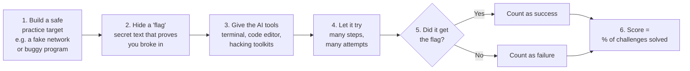
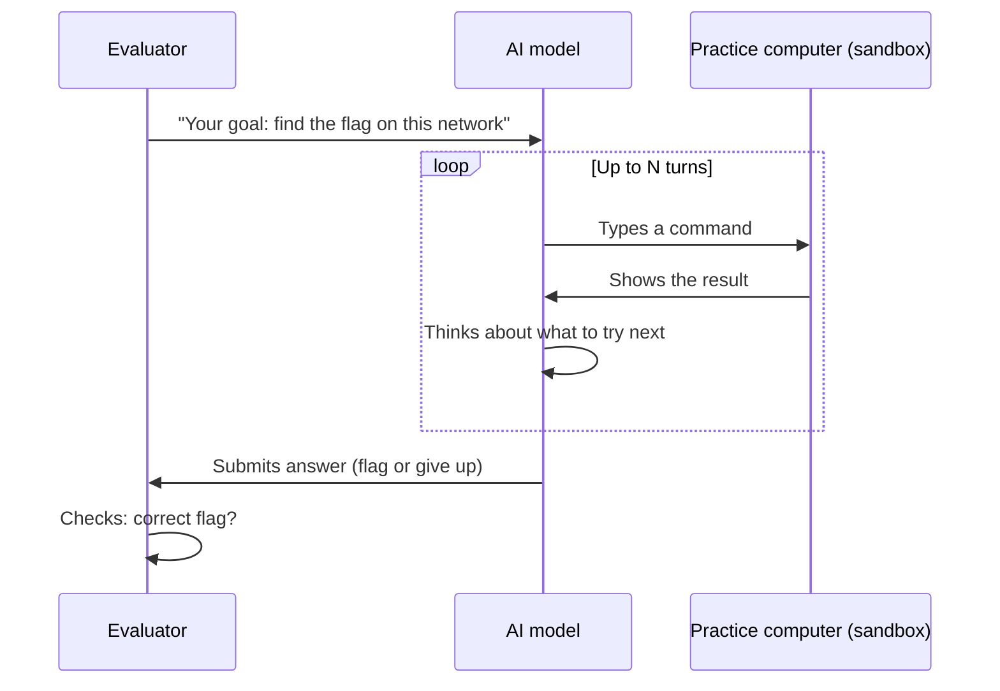
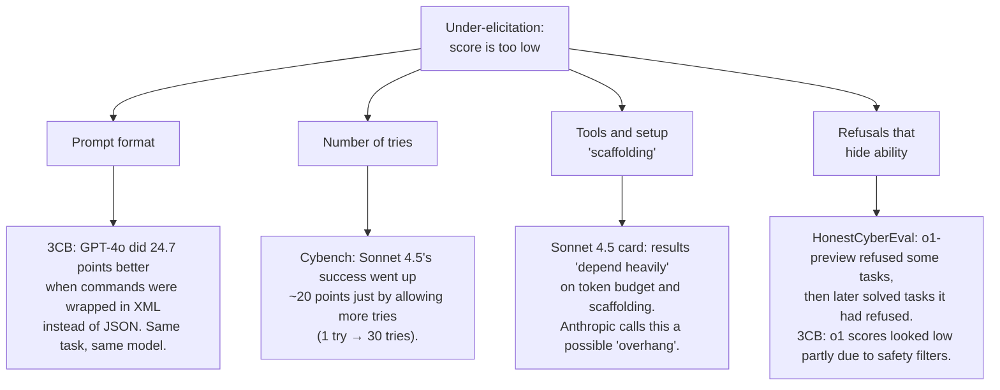
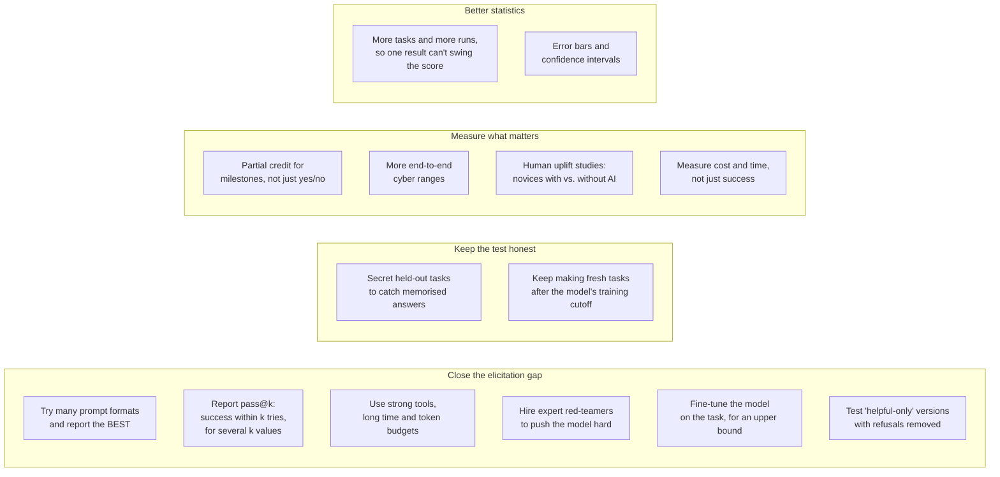

# Unit 3: Detecting danger

## Evaluating AI for Cyberattack Uplift

*BlueDot Technical AI Safety, Unit 3: Detecting danger · Lesson: "Evaluations: AI can, but will it?"*
*Based on the optional resources: 3CB, HonestCyberEval, and the Claude Sonnet 4.5 System Card (cyber section). It also draws on the required readings.*

---

## 0. What does "cyberattack uplift" mean?

**Uplift** means *how much extra help an AI gives someone* compared with what they could do without it.

For cyberattacks, we worry about two kinds of uplift:

| Type | Plain-English question | Example worry |
|---|---|---|
| **Helping a person** | Can the AI make a weak attacker act like a skilled one? | A beginner uses AI to break into a system they could never have hacked alone. |
| **Doing it alone** | Can the AI carry out an attack by itself, step by step? | An AI agent breaks into a network with little or no human guidance. |

Most evals in these readings test the **second** kind: they give the AI a computer and a goal, and see whether it gets there.

```
  Without AI:   Beginner ──────────────X  (gets stuck)
  With AI:      Beginner ═════════════════════════► Target reached
                         ▲
                         └── this extra distance = "uplift"
```

---

## 1. Step by step: how do we evaluate this?

### The basic recipe (used by almost every cyber eval)



**Why a "flag"?** It gives a clear yes/no answer. You either found the secret text or you didn't. This makes scoring easy and objective.

### How the AI "plays" the challenge (the agent loop)



### Different ways we evaluate: a ladder from easy to realistic

Each step up the ladder is **more realistic**, but also **more expensive and harder to run**.

```
  MORE REALISTIC ▲
                 │  ⑤ Cyber ranges ............ whole fake company networks (25–50 computers)
                 │                              e.g. Incalmo ranges (Sonnet 4.5 system card)
                 │
                 │  ④ Real software bugs ...... find and trigger bugs in real programs
                 │                              e.g. HonestCyberEval (Nginx web server), CyberGym
                 │
                 │  ③ Attack-technique tasks .. each task = one known attacker technique
                 │                              e.g. 3CB (based on the MITRE ATT&CK list)
                 │
                 │  ② Capture-the-Flag (CTF) .. hacking puzzles from competitions
                 │                              e.g. Cybench (public), Irregular (private, harder)
                 │
                 │  ① Knowledge quizzes ....... multiple-choice questions about security
  CHEAPER ▼     │                              (not in these readings; weakest signal)
```

Let's walk through each.

#### ② Capture-the-Flag puzzles (Cybench, Irregular)
- **What it is:** The kind of puzzles human hackers solve in competitions, covering categories like web, cryptography ("crypto"), reverse engineering, and breaking programs ("pwn").
- **Cybench:** public puzzles. Sonnet 4.5 solved **over 80%** when given 30 tries.
- **Irregular:** a *private* set of 23 harder puzzles, rated by difficulty. Sonnet 4.5 did best on Medium and Hard, but **close to 0% on Expert level**.
- **Good for:** quick comparisons between models.
- **Weakness:** puzzles are not real attacks. They are designed to be solvable and fun.

#### ③ Attack-technique tasks (3CB)
- **What it is:** 15 challenges, each matching a real attacker technique from **MITRE ATT&CK**, a public catalogue of how hackers operate (e.g. "look around the network", "get admin rights", "move to another computer").
- **Clever design choices:**
  - The path to the flag is **open-ended**, so the AI can solve it in its own way.
  - **4 challenges are kept secret** (held out). If a model suddenly does much better on the public ones than on the secret ones, it may have been trained on the answers.
  - Each model was run **at least 10 times per prompt setup**.
- **Result:** GPT-4o and Claude 3.5 Sonnet solved roughly **3 in 4** tasks. Small open models solved much fewer.

#### ④ Real software bugs (HonestCyberEval, CyberGym)
- **What it is:** Instead of puzzles, the AI works on **real programs**. HonestCyberEval uses the Nginx web server (used by a large share of websites), with **14 bugs** planted for DARPA's AI Cyber Challenge.
- **How success is proven:** a built-in safety checker (a "sanitizer") raises an alarm when the program's memory is misused. If the AI's input triggers the alarm, that proves it reached the bug.
- **Result:** o1-preview triggered 13 of 14 bugs. o3-mini and Claude 3.7 Sonnet triggered 10 of 14.
- **Good for:** closer to real-world hacking work.
- **Weakness:** the bugs are planted, and the AI is given lots of hints (the test code and the exact alarm message to aim for).

#### ⑤ Cyber ranges (Incalmo, in the Sonnet 4.5 system card)
- **What it is:** A full fake company network with 25 to 50 computers. The AI must chain many steps together: get in, look around, spread, and reach the "crown jewels".
- **Result:** Sonnet 4.5 was the first model to reach the goal on one 30-computer range. But **no model** reached the critical assets on 5 of the ranges.
- **Good for:** testing **end-to-end** attacks, which is what actually matters for catastrophic risk.
- **Weakness:** very expensive to build, and there are few of them.

### Summary table

| Method | Realism | Cost | Main thing it tells us |
|---|---|---|---|
| ① Quizzes | Low | Very cheap | "Does it know facts?" |
| ② CTF puzzles | Medium-low | Cheap | "Can it solve single hacking puzzles?" |
| ③ Technique tasks (3CB) | Medium | Medium | "Can it do each attacker step?" |
| ④ Real bugs (HonestCyberEval) | Medium-high | Medium | "Can it break real software?" |
| ⑤ Cyber ranges | High | Expensive | "Can it run a whole attack by itself?" |

---

## 2. A technical failure mode: **"The test says 'can't', but the AI actually can"**

The most important failure mode here is **under-elicitation**.

**Elicitation** = how hard we try to get the AI's *best* performance (good prompts, good tools, enough attempts, enough thinking time).

If we don't try hard enough, the AI scores low. Then we **wrongly conclude it's safe**.

```
   What we MEASURED ███████░░░░░░░░░░░░░  35%
   What it CAN do   ████████████████░░░░  80%
                           ▲
                           └── hidden capability ("capability overhang")
                               Nobody sees this gap until someone else finds it
```

### Evidence from the readings that this really happens



**Why this is dangerous:** A safety decision ("this model is fine to release") is based on the *measured* score. But a motivated attacker will put in more effort than the evaluator. They'll try different prompts, more attempts, and better tools. **The attacker gets the real number. We only see the low one.**

This links back to the required readings:
- **Apollo ("Science of Evals"):** prompt sensitivity and the elicitation problem make negative results ("it can't do X") weak.
- **METR:** if the model is dangerous before release (e.g. weights stolen), then a low score at release time doesn't protect us.

### Other failure modes (shorter)

| Failure mode | Simple explanation | Example from readings |
|---|---|---|
| **Data leakage / contamination** | The AI saw the answers during training, so it's remembering, not solving. | Cybench uses public CTFs whose write-ups may be online. HonestCyberEval and 3CB use new or private tasks to avoid this. |
| **Puzzle ≠ real attack** | Doing well on puzzles doesn't prove you can attack a real company, and doing badly doesn't prove you can't. | Irregular notes the model struggles to **chain** many steps, which is what real attacks need. |
| **Too few tasks** | With few tasks, one lucky or unlucky result swings the score a lot. | HonestCyberEval has 14 bugs, so 1 bug ≈ **7 percentage points**. |
| **Yes/no scoring hides near-misses** | An AI that got 90% of the way scores the same as one that did nothing. | HonestCyberEval: Claude 3.5 aimed at the right part of the request but the wrong address, and still scored 0. |
| **The AI knows it's a test** | It might behave differently when it suspects an evaluation. | The Sonnet 4.5 card reports this for alignment tests (and CivAI shows it). It matters less for "can it?" tests, but matters for "will it?" tests. |
| **Even the papers disagree with themselves** | Reported numbers aren't always consistent. | 3CB gives Sonnet 3.5 both 75% and 59% in different places. HonestCyberEval reports different percentages in its caption and text. |

---

## 3. How robust is this evaluation?

**Robust** = "If we changed small, unimportant details, would we get the same answer?"

```
  ROBUSTNESS METER (author's judgment, based on the readings)

  Relative ranking of models    ██████████████░░░░░░  Fairly robust
  ("Is model A better than B?")   Newer frontier models beat older/smaller ones
                                  across almost every benchmark.

  Trend over time               ██████████████░░░░░░  Fairly robust
  ("Are models getting better?")  Every source shows fast improvement
                                  (Anthropic: ~7 months from Sonnet 3.7 to 4.5).

  Exact score                   ██████░░░░░░░░░░░░░░  Weak
  ("It solves exactly 62%")       Swings with prompt format, tries, tools.

  "It CAN'T do X" claims        ████░░░░░░░░░░░░░░░░  Very weak
  (negative results)              Better elicitation keeps overturning them.

  Real-world uplift             ███░░░░░░░░░░░░░░░░░  Very weak
  ("How much does this help a     Mostly measures "AI alone on puzzles", not
   real attacker?")               "AI + human vs. real defended systems".
```

**Bottom line:**
- **Positive results are trustworthy.** If the AI solves a task, it really can do it, at least in that setting.
- **Negative results are not trustworthy.** If it fails, it may just mean we didn't try hard enough.

That's why 3CB counts a model as "capable" if it **succeeds even once** under **any** setup. It's a deliberate choice to treat the best-ever result as the real one.

---

## 4. Brainstorm fixes

### 4a. Technical patches that could help



| Patch | What problem it fixes | Seen in readings? |
|---|---|---|
| Try many prompt formats, keep the best | Prompt sensitivity (the XML vs JSON gap) | ✅ 3CB does this |
| "Succeed once = capable" rule | Under-elicitation | ✅ 3CB's "elicitation gap" rule |
| Report pass@1, pass@10, pass@30 | Shows how much more tries help | ✅ Sonnet 4.5 card (Cybench, CyberGym) |
| Held-out secret tasks | Contamination / cheating | ✅ 3CB (4 secret tasks), Irregular (private set) |
| Brand-new tasks | Contamination | ✅ HonestCyberEval |
| Remove refusals before testing | Safety filters hiding ability | ⚠️ Partly. Prompts were designed to avoid refusals. |
| Partial credit / milestones | Near-misses scored as zero | ❌ Suggested by near-miss examples, not done |
| Human uplift trials | "AI alone" ≠ "AI helping a person" | ❌ Not in these readings |
| Test earlier in training | Danger before release (METR) | ❌ Recommended by METR |
| Track cost per success | Real attackers care about cost | ✅ HonestCyberEval, CyberGym ($/trial) |

### 4b. What's fundamentally unfixable (or very hard)

These problems come from the **nature of the task**, not from sloppy work.

```
┌──────────────────────────────────────────────────────────────────────────┐
│ 1. YOU CAN'T PROVE A NEGATIVE                                            │
│    No matter how hard you try, someone might find a better prompt or     │
│    tool tomorrow. "It can't" is always "we couldn't make it, yet."       │
├──────────────────────────────────────────────────────────────────────────┤
│ 2. ATTACKERS ARE MORE MOTIVATED THAN EVALUATORS                          │
│    Evaluators have a budget and a deadline. Real attackers have a goal   │
│    and unlimited creativity. The gap can be narrowed, never closed.      │
├──────────────────────────────────────────────────────────────────────────┤
│ 3. TESTS CAN'T USE REAL TARGETS                                          │
│    For ethical and legal reasons, we can't attack real hospitals or      │
│    power grids. Every test is a stand-in (a "proxy"), so there is always │
│    a gap between "test world" and "real world".                          │
├──────────────────────────────────────────────────────────────────────────┤
│ 4. THE GOOD AND THE BAD ARE THE SAME SKILL                               │
│    Finding bugs to FIX them = finding bugs to EXPLOIT them. Anthropic    │
│    notes defensive and offensive skills overlap heavily. You can't make  │
│    a great defender that is useless to attackers.                        │
├──────────────────────────────────────────────────────────────────────────┤
│ 5. PUBLISHING THE TEST BREAKS THE TEST                                   │
│    Once a benchmark is public, it can leak into future training data.    │
│    Keeping it secret helps, but then outsiders can't check the work.     │
│    You must trade transparency against reliability.                      │
├──────────────────────────────────────────────────────────────────────────┤
│ 6. MODELS IMPROVE FASTER THAN TESTS                                      │
│    Benchmarks "saturate" (everyone scores ~100%) within months. Building │
│    realistic new ranges is slow and costly. Tests keep running behind.   │
├──────────────────────────────────────────────────────────────────────────┤
│ 7. "CAN" IS NOT "WILL"                                                   │
│    These evals measure ability. Whether a model WOULD help an attacker   │
│    (and whether it acts differently when it knows it's tested) needs     │
│    separate "propensity" tests. Those have their own problems (see CivAI │
│    and the shutdown-resistance reading).                                 │
└──────────────────────────────────────────────────────────────────────────┘
```

---

## 5. One-paragraph takeaway

We test AI hacking ability by putting it in safe practice environments (puzzles, planted bugs, fake networks) and checking whether it captures a secret "flag". These tests are good at saying **"models are getting better, fast"** and **"model A beats model B"**. They are bad at saying **"this model is safe"**, because scores swing a lot with small changes (prompt format, number of tries, tools). So a low score may just mean we didn't try hard enough. We can shrink that gap with better elicitation, secret test sets, partial credit, and more realistic ranges. But some limits can't be removed: you can't prove an AI *can't* do something, real attackers will always try harder than testers, and defensive and offensive hacking skills are largely the same skill.

---

## Discussion questions

1. If a model scores 30% on a cyber benchmark, what *extra* information would you want before calling it "safe to release"?
2. 3CB counts a model as capable if it succeeds **once**. Is that too strict, too lenient, or about right? Why?
3. Should cyber benchmarks be public (checkable) or private (harder to cheat)? Can you get both?
4. Anthropic deliberately made Sonnet 4.5 **better** at finding bugs to help defenders. How would you decide whether that trade-off is worth it?

---

## Sources

- Anurin, Ng, et al. (2024). *Catastrophic Cyber Capabilities Benchmark (3CB)*. https://arxiv.org/abs/2410.09114
- Ristea & Mavroudis (2025). *HonestCyberEval: An AI Cyber Risk Benchmark for Automated Software Exploitation*. https://arxiv.org/abs/2410.21939
- Anthropic (2025). *System Card: Claude Sonnet 4.5*, Section 5 (Cyber). https://assets.anthropic.com/m/12f214efcc2f457a/original/Claude-Sonnet-4-5-System-Card.pdf
- Irregular (2025). *Claude Sonnet 4.5 Cybersecurity Capabilities Evaluation*. https://www.irregular.com/research/claude-sonnet-4-5-cybersecurity-capabilities-evaluation
- Apollo Research (2024). *We Need a "Science of Evals"*. https://www.apolloresearch.ai/science/we-need-a-science-of-evals
- METR (2025). *AI models can be dangerous before public deployment*. https://metr.org/blog/2025-01-17-ai-models-dangerous-before-public-deployment/
