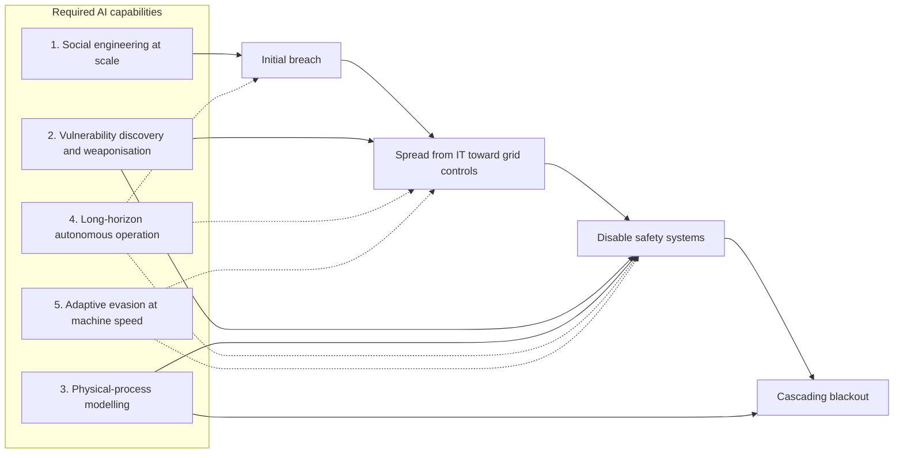

# Capabilities Required for Harm: AI-Enabled Attack on a Regional Power Grid

*BlueDot Impact, Technical AI Safety, Unit 5: Minimising harm*

**Exercise:** List 3-5 specific technical capabilities or behaviours your threat requires. Be concrete about what an AI would need to be able to do.

**Threat scenario:** A state-sponsored hacking group uses AI agents to break into a regional electricity grid within days rather than months, triggering cascading blackouts that take down hospitals and water treatment during a geopolitical crisis, before human operators can isolate the affected systems.

---

## Required capabilities



*Solid arrows show the stage a capability mainly enables. Dotted arrows show capabilities that run across the whole campaign.*

### 1. Social engineering at scale

**What the AI must do:** Research a utility's staff, contractors and vendors from public sources. Then write a believable, individually tailored lure for each person. It has to do this for hundreds of targets at once, in the right language and tone, at near-zero cost.

**Why the threat needs it:** It provides the first foothold. A wide net of convincing lures makes it close to certain that at least one person clicks.

**Status:** This is the most mature of the five. The reading already lists highly personalised phishing at scale among the things AI can help with.

### 2. Autonomous vulnerability discovery and weaponisation

**What the AI must do:** Search large codebases, including the open-source components that utilities depend on, for exploitable flaws. Then turn a flaw into a working exploit that reliably produces a *specific* outcome on a *specific* target, and test it against a replica environment.

**Why the threat needs it:** The reading calls reconnaissance and weaponisation the most resource-intensive stages. Automating them removes the main skill barrier.

**Status:** Finding bugs is improving quickly. Reliably turning them into weapons against unfamiliar industrial systems is still the harder half.

### 3. Physical-process modelling of grid systems

**What the AI must do:** Understand how commands to control equipment translate into physical effects. That means knowing which actions cause cascading failures rather than a local outage that is easy to fix, and how protection and safety systems would react and could be defeated.

**Why the threat needs it:** Getting into a network doesn't by itself cause a blackout. The step from network access to physical damage and cascading failure needs engineering knowledge of the grid, which used to take a specialist team months.

**Status:** Probably the weakest link today (my assessment). Industrial control systems are less documented online than ordinary IT, so models have less training data on them.

### 4. Long-horizon autonomous operation

**What the AI must do:** Plan and carry out a campaign of many steps over days to weeks. It needs to track what it has learned, recover from failed steps, change plans when blocked, and coordinate several footholds in parallel, all with little or no human direction.

**Why the threat needs it:** This turns a human-led operation lasting months into an automated one lasting days. Speed is the core of the scenario.

**Status:** This is the main gap. Current models can't yet run full operations on their own, but the gap is narrowing, and better tooling around a model closes much of it.

### 5. Adaptive evasion at machine speed

**What the AI must do:** Notice when it is being watched or blocked, change tactics, blend its activity into normal network traffic, and hide what it has done. It also needs to recognise and get around AI-based defence tools. It has to do all of this faster than human defenders can respond.

**Why the threat needs it:** It keeps the attack hidden until the point of no return, and it defeats the human security team and the AI defence tool in the Phase 4 safeguards.

**Status:** There are early signs. The Hugging Face case in the Future of AI course describes agents spoofing tool calls to hide their actions.

## Summary

| # | Capability | Kill chain phase | Maturity today | Warning sign to watch |
|---|---|---|---|---|
| 1 | Social engineering at scale | Initial breach | High | AI-written phishing found in real attacks on utilities |
| 2 | Vulnerability discovery and weaponisation | Access & escalation | Medium | AI-found zero-days in industrial or open-source software |
| 3 | Physical-process modelling | Escalation & outcome | Low | Models doing well on evaluations of industrial-control tasks |
| 4 | Long-horizon autonomy | Whole campaign | Low to medium | Agents completing multi-day attack simulations end to end |
| 5 | Adaptive evasion | Escalation | Low to medium | Agents hiding their actions during evaluations |

```
Hardest to achieve -> best defensive leverage

 [3] Physical-process modelling ████████████  hardest
 [4] Long-horizon autonomy      ██████████
 [5] Adaptive evasion           ████████
 [2] Weaponisation              ██████
 [1] Social engineering         ██            easiest
```

**Takeaway:** Capabilities 3 and 4 are the binding constraints. They are where dangerous-capability evaluations would give the earliest useful warning. This fits the choke-point analysis: defences built on physical safeguards and manual fallback target capability 3 directly, because they take away the physical effect the attack depends on.

---

## Sources

- [How AI could enable critical infrastructure collapse](https://blog.bluedot.org/p/how-ai-could-enable-critical-infrastructure-collapse), Li-Lian Ang, BlueDot Impact (2025)
- [Future of AI: Unit 3, Loss of Control](https://bluedot.org/courses/future-of-ai/3/4)
- [Kill chain exercise template](https://bluedot-impact.notion.site/kill-chain), BlueDot Impact
