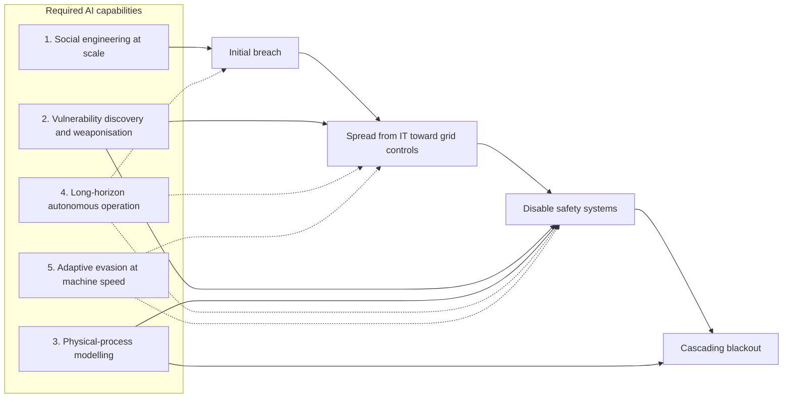

# Kill Chain Exercise: AI-Enabled Attack on a Regional Power Grid

*BlueDot Impact, Technical AI Safety, Unit 5: Minimising harm*

> Numbers below are illustrative estimates, not forecasts. Attack details are kept high-level; the focus is on where defenders can intervene.

## Threat scenario

**Most concerning pathway:** AI compressing the *time* an attack takes. Infrastructure has rarely collapsed so far because attacks are slow to prepare (Triton took about two years; the Ukraine grid attack needed months of access inside the network), and that time is what defenders rely on to detect and respond. AI that shrinks preparation to weeks and execution to minutes erodes that buffer. It also pushes operators to depend on AI defenders, which can themselves be poisoned or blinded.

**Scenario sentence:**

> The **state-sponsored hacking group** with **AI agents that automate reconnaissance and vulnerability discovery across widely used open-source industrial software** and **a motivation to coerce a rival government during a geopolitical crisis while keeping plausible deniability** attacks **a regional electricity grid** by **using AI-personalised spearphishing for initial access, then AI-accelerated exploitation to reach control systems in days rather than months** in order to **trigger cascading blackouts that take down hospitals and water treatment before human operators can isolate the affected systems.**

**Runner-up:** poisoning the AI defence systems themselves. It is less likely today but becomes more dangerous the more operators rely on AI to respond quickly.

---

## Phase 1: Capability emergence

**What AI capability makes this attack possible?**

- **Required capability:** Autonomous discovery and exploitation of software vulnerabilities, especially in industrial control and open-source software. The AI also needs to run a multi-stage operation as an agent, with little human direction.
- **Current capability gap:** Current models can't yet run full operations on their own, but the gap is narrowing. Extra tooling around a model closes much of it: in one study, a smaller model with the Incalmo framework exfiltrated all 25 target files, while a larger model without it got only one. The missing pieces are reliability over long campaigns and expertise in grid control systems.
- **Warning signs we'd see first:**
  - Frontier model safety reports crossing offensive-cyber thresholds
  - AI-discovered zero-days in industrial software
  - AI-assisted campaigns against infrastructure, like the reported Vietnam case
  - Attack tools getting dramatically cheaper (e.g. adaptive ransomware built for about $0.70)

## Phase 2: Access & weaponisation

**How does the attacker get and prepare the capability?**

- **Access method:** An open-weight model fine-tuned for offensive work, plus frontier API access through accounts disguised as legitimate security research.
- **Preparation steps:**
  - Connect the model to attack tooling and agent frameworks.
  - Build a replica of the target's control-system environment for practice.
  - Use AI to gather open-source information on the utility's staff, vendors and suppliers.
- **Time required:** Weeks to a few months, compared with about two years for Triton.

## Phase 3: Initial breach

**What's the first domino to fall?**

- **Entry point:** An employee or contractor on the utility's corporate IT side.
- **Method:** AI-written phishing personalised to each target and sent at scale.
- **Detection likelihood:** Low. It looks like ordinary phishing, and the corporate network is not the critical system, so a successful click may go unnoticed or be treated as routine.

## Phase 4: Escalation cascade

**How does initial success compound?**

- **Propagation mechanism:** The AI agent maps the network and moves from corporate IT toward the systems that run the grid. It adapts to defences faster than humans can respond. It may also set up footholds in several utilities at once.
- **Failed safeguards:**
  1. **Network separation.** It is bypassed through a forgotten remote-access route or a misconfiguration.
  2. **The human security team.** Alerts come too fast and look like normal noise.
  3. **The AI defence tool.** It has been blinded through poisoned data, turning a defence into an attack vector.
- **Point of no return:** The attacker controls the grid systems, has disabled the safety and protection systems, and starts physically damaging equipment. After that, recovery means replacing hardware, not just restarting systems.

## Phase 5: Societal breakdown

**What fails at the human and institutional level?**

- **Trust collapse:** People stop trusting the utilities, the energy regulators, and the government's ability to say who did it. AI security vendors whose tools failed lose credibility too.
- **Coordination failure:** Attribution is slow and uncertain, so there is no clear target for a response. Power, water, telecoms and hospitals fail together, and the blackout itself disrupts communications between responders. Nobody has a plan for attacks that move at machine speed.
- **Public reaction:** Paralysis and confusion at first. Then panic buying of fuel and water, and misinformation filling the gap about who is responsible.

## Phase 6: Catastrophic outcome

**What do people see, feel and lose?**

- **First 24 hours:**
  - Headlines report a region-wide blackout with no known cause.
  - Hospitals run on generators, cancel planned surgeries, and struggle to keep intensive care running.
  - Traffic lights go out. Mobile networks fail as backup batteries at cell towers run down. Water pressure drops.
- **First week:**
  - Water treatment and pumping fail as generator fuel runs out, so boil-water notices go out.
  - Petrol stations can't pump fuel. Food and medicines that need refrigeration spoil.
  - The head of government declares a national emergency, deploys military generators, and promises to find who did it, but can't yet say.
- **Irreversible damage (illustrative):**
  - **Deaths:** dozens to hundreds, from hospital failures, people on home medical devices, and heat or cold exposure. Even one hospital outage can kill, as the German hospital ransomware case showed.
  - **Economic loss:** tens of billions of dollars. NotPetya alone caused more than $10 billion in damage.
  - **What never recovers:** damaged large transformers, which can take many months to replace. Trust in automated infrastructure. And the precedent that deniable AI-enabled attacks work.

## Phase 7: Identify choke points

**When could we notice? What's the detection window?**

| Stage | Choke point | Detection window |
|---|---|---|
| Capability emergence | Test models for dangerous capabilities before release, and withhold offensive-cyber abilities in deployed models | Months to years |
| Access & weaponisation | AI providers monitor for misuse and shut accounts down; stronger identity checks for powerful models | Weeks to months |
| Initial breach | Phishing-resistant login (hardware security keys); fund patching of the open-source code infrastructure relies on | Days |
| **Escalation** | **Strictly separate IT from grid control systems; physically independent safety systems; ability to run the grid manually; pre-approved automatic isolation** | **Hours to minutes** |
| Societal breakdown | Backup fuel at hospitals and water plants; mutual-aid agreements between utilities; backup communication channels | After impact |

**Strongest choke point:** the step from corporate IT into the grid's control systems. It is the last place to stop the attack before physical damage. The best defences there don't depend on human speed: physical separation of networks, hardwired safety systems, and the ability to fall back to manual operation. Since the scenario is about AI compressing timelines, defences that work at any speed matter most.

Upstream, misuse monitoring by AI providers (Phase 2) is the cheapest place to intervene, but it doesn't help against open-weight models.

---

## Capabilities required for harm



*Solid arrows show the stage a capability mainly enables. Dotted arrows show capabilities that run across the whole campaign.*

### 1. Social engineering at scale

**What the AI must do:** Research a utility's staff, contractors and vendors from public sources. Then write a believable, individually tailored lure for each person. It has to do this for hundreds of targets at once, in the right language and tone, at near-zero cost.

**Why the threat needs it:** It provides the first foothold. A wide net of convincing lures makes it close to certain that at least one person clicks.

**Status:** This is the most mature of the five. The reading already lists highly personalised phishing at scale among the things AI can help with.

### 2. Autonomous vulnerability discovery and weaponisation

**What the AI must do:** Search large codebases, including the open-source components that utilities depend on, for exploitable flaws. Then turn a flaw into a working exploit that reliably produces a *specific* outcome on a *specific* target, and test it against a replica environment.

**Why the threat needs it:** The reading calls reconnaissance and weaponisation the most resource-intensive stages. Automating them removes the main skill barrier.

**Status:** Finding bugs is improving quickly. Reliably turning them into weapons against unfamiliar industrial systems is still the harder half.

### 3. Physical-process modelling of grid systems

**What the AI must do:** Understand how commands to control equipment translate into physical effects. That means knowing which actions cause cascading failures rather than a local outage that is easy to fix, and how protection and safety systems would react and could be defeated.

**Why the threat needs it:** Getting into a network doesn't by itself cause a blackout. The step from network access to physical damage and cascading failure needs engineering knowledge of the grid, which used to take a specialist team months.

**Status:** Probably the weakest link today (my assessment). Industrial control systems are less documented online than ordinary IT, so models have less training data on them.

### 4. Long-horizon autonomous operation

**What the AI must do:** Plan and carry out a campaign of many steps over days to weeks. It needs to track what it has learned, recover from failed steps, change plans when blocked, and coordinate several footholds in parallel, all with little or no human direction.

**Why the threat needs it:** This turns a human-led operation lasting months into an automated one lasting days. Speed is the core of the scenario.

**Status:** This is the main gap. Current models can't yet run full operations on their own, but the gap is narrowing, and better tooling around a model closes much of it.

### 5. Adaptive evasion at machine speed

**What the AI must do:** Notice when it is being watched or blocked, change tactics, blend its activity into normal network traffic, and hide what it has done. It also needs to recognise and get around AI-based defence tools. It has to do all of this faster than human defenders can respond.

**Why the threat needs it:** It keeps the attack hidden until the point of no return, and it defeats the human security team and the AI defence tool in the Phase 4 safeguards.

**Status:** There are early signs. The Hugging Face case in the Future of AI course describes agents spoofing tool calls to hide their actions.

### Summary

| # | Capability | Kill chain phase | Maturity today | Warning sign to watch |
|---|---|---|---|---|
| 1 | Social engineering at scale | Initial breach | High | AI-written phishing found in real attacks on utilities |
| 2 | Vulnerability discovery and weaponisation | Access & escalation | Medium | AI-found zero-days in industrial or open-source software |
| 3 | Physical-process modelling | Escalation & outcome | Low | Models doing well on evaluations of industrial-control tasks |
| 4 | Long-horizon autonomy | Whole campaign | Low to medium | Agents completing multi-day attack simulations end to end |
| 5 | Adaptive evasion | Escalation | Low to medium | Agents hiding their actions during evaluations |

```
Hardest to achieve -> best defensive leverage

 [3] Physical-process modelling ████████████  hardest
 [4] Long-horizon autonomy      ██████████
 [5] Adaptive evasion           ████████
 [2] Weaponisation              ██████
 [1] Social engineering         ██            easiest
```

**Takeaway:** Capabilities 3 and 4 are the binding constraints. They are where dangerous-capability evaluations would give the earliest useful warning. This fits the choke-point analysis: defences built on physical safeguards and manual fallback target capability 3 directly, because they take away the physical effect the attack depends on.

---

## Sources

- [How AI could enable critical infrastructure collapse](https://blog.bluedot.org/p/how-ai-could-enable-critical-infrastructure-collapse), Li-Lian Ang, BlueDot Impact (2025)
- [Kill chain exercise template](https://bluedot-impact.notion.site/kill-chain), BlueDot Impact
- [Technical AI Safety: Unit 5, Building defences](https://bluedot.org/courses/technical-ai-safety/5/2)
- [Future of AI: Unit 3, Loss of Control](https://bluedot.org/courses/future-of-ai/3/4)
