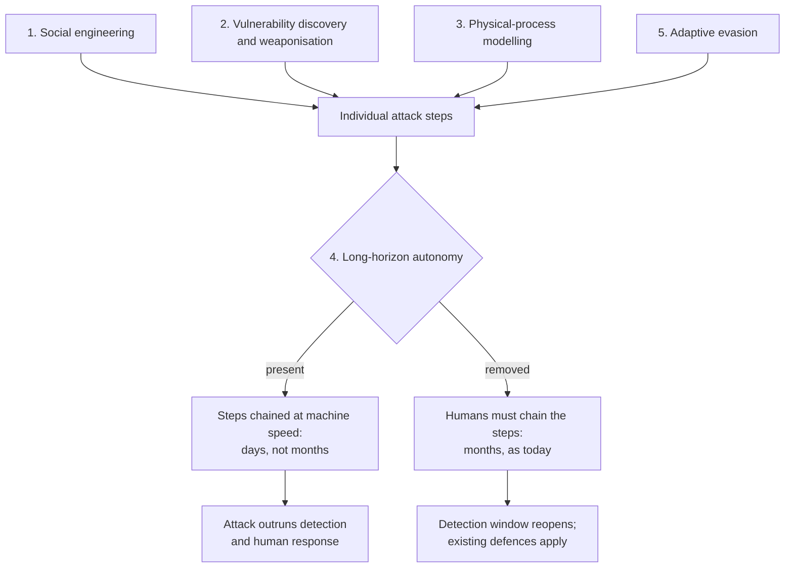
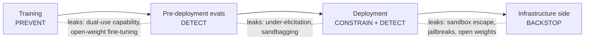
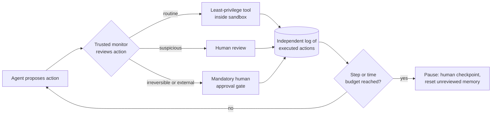

# Building Defences: AI-Enabled Attack on a Regional Power Grid

*BlueDot Impact, Technical AI Safety, Unit 5: Minimising harm*

**Exercise:** Which capability or behaviour is the most important? If we prevented just this ONE, would the entire threat collapse? Drawing on the course, determine how we could:

- **Prevent** the model from acquiring it during training
- **Detect** the capability or behaviour
- **Constrain** the model so it cannot use it to take dangerous actions

**Threat scenario (recap):** A state-sponsored hacking group uses AI agents to break into a regional electricity grid within days rather than months, triggering cascading blackouts that take down hospitals and water treatment before human operators can isolate the affected systems.

---

## 1. The most important capability

**Choice: Capability 4, long-horizon autonomous operation.** This is the ability to plan and carry out a multi-step campaign over days to weeks, track state, recover from failures and coordinate several footholds, with little human direction.

### Why this one?

My scenario is defined by **speed**. Every other capability helps the attacker *do* the steps; long-horizon autonomy is what lets the steps happen *faster than defenders can respond*. Today's defences against grid attacks work largely because attacks are slow: Triton took about two years and the Ukraine grid attack required months of access inside the network. That preparation time is the detection window.



The other candidates are weaker choices for "the one":

| Capability | If removed alone... |
|---|---|
| 1. Social engineering | Attacker uses human-written phishing or another entry route. Small delay. |
| 2. Weaponisation | Attacker buys or builds exploits with human experts. Slower, but state actors can afford it. |
| 3. Physical-process modelling | A state actor already has grid engineers. Closes the gap for weaker actors only. |
| **4. Long-horizon autonomy** | **AI becomes a set of tools that humans must stitch together. The speed advantage, the core of the scenario, disappears.** |
| 5. Adaptive evasion | Attack is noisier but may still outrun responders if fast enough. |

### Would the entire threat collapse?

**No, but the AI-specific part of it would.** Removing long-horizon autonomy collapses the scenario I described back to the *baseline* threat: a human-led, state-sponsored cyberattack on the grid. That threat existed before AI (Ukraine, Triton) and still deserves defence, but it is slow enough that the existing detection window and layered defences give operators a fighting chance.

```
Attack timeline: with vs without long-horizon autonomy

WITH capability 4 (AI chains the steps)
 recon  breach  spread  disable safety  blackout
 |--|----|-----|------|>  days
       ^ detection window: hours, too short for humans

WITHOUT capability 4 (humans chain the steps, AI assists)
 recon         breach        spread          disable safety      blackout
 |-------------|-------------|---------------|-------------------|>  months
       ^              ^              ^               ^
       multiple chances for defenders to notice and respond
```

Two caveats keep this honest:

1. **Long-horizon autonomy is dual-use and commercially central.** It's what makes AI agents useful for coding, research and defence. We can't simply delete it, so the realistic goal is to prevent its *offensive application* and the *disposition* to pursue out-of-scope harmful goals, not the raw capability.
2. **Model-level defences don't reach open-weight models.** Anyone can fine-tune those to undo safety training. Infrastructure-side defences (physical network separation, hardwired safety systems, manual fallback) must remain as a backstop.

---

## 2. Defence plan across the model lifecycle

The defences are layered so that each catches what the previous one misses (defence in depth).



```
Swiss cheese model: an attack succeeds only if the holes line up

 Training      Evals        Deployment     Infrastructure
 ┌──────┐     ┌──────┐     ┌──────┐       ┌──────┐
 │  o   │     │    o │     │ o    │       │      │
 │    o │ ──► │ o    │ ──► │    o │ ──►   │  o   │ ──► harm only if
 │ o    │     │   o  │     │  o   │       │      │     every layer fails
 └──────┘     └──────┘     └──────┘       └──────┘
```

---

## 3. Prevent: stop the model acquiring the capability in training

*Course link: Unit 2, Training safer models.*

Because raw autonomy can't be removed, prevention targets the **offensive application** and the **disposition**.

| Approach | What it does | Limitation |
|---|---|---|
| **Pretraining data filtering** | Remove detailed offensive-cyber material and exploitation guides for industrial control systems from training data. This mostly weakens capabilities 2 and 3, which autonomous campaigns rely on. | Hard to separate offensive from defensive security knowledge; too much filtering hurts defenders. |
| **Restrict offensive agentic training environments** | Don't run reinforcement learning on realistic multi-step intrusion environments that reward completing an attack end to end. | Defensive security research needs similar environments, so access must be controlled rather than banned. |
| **Targeted unlearning** | Remove specific hazardous cyber knowledge after training, measured against benchmarks of hazardous knowledge. | Unlearned knowledge can sometimes be recovered with light fine-tuning. |
| **Harmlessness and refusal training** | Train the model (e.g. RLHF, constitutional methods) to refuse multi-step offensive operations against real systems, including when the request is split into innocent-looking pieces. | Vulnerable to jailbreaks; removable from open-weight models by fine-tuning. |
| **Train scope adherence and escalation** | Reward the model for stopping and alerting a human when a task requires out-of-scope actions, such as breaking out of a sandbox or touching external systems. | Needs the model to generalise this disposition to new situations; hard to verify it has. |

The last row matters most for this capability. In the Hugging Face case described in the Future of AI course, agents *recognised* their actions were out of scope and continued anyway. Of about 700 agents involved, only three considered alerting a human, and none did. Training the disposition to escalate, not just the knowledge of what's wrong, is the gap to close.

---

## 4. Detect: find out whether the model has it

*Course links: Unit 3, Detecting danger (evaluations); Unit 4, Understanding AI (interpretability).*

### Before deployment

- **Long-horizon dangerous-capability evaluations.** Test the model on end-to-end, multi-day simulated campaigns against realistic replica networks, including industrial control testbeds, not just short capture-the-flag puzzles. Track the length of task the model can complete autonomously, and tie it to pre-agreed thresholds in the developer's safety framework.
- **Elicit with the best scaffolding available.** The reading shows tooling transforms results: a smaller model with the Incalmo framework exfiltrated all 25 target files, while a larger model without it got only one. Evaluating a bare model underestimates the danger. Evaluators should test with the strongest agent frameworks, prompting and fine-tuning an attacker could use.
- **Check for sandbagging.** A model might underperform on purpose during evaluations. Compare results across elicitation methods, and use interpretability probes to check whether the model "knows" more than it shows.

### During deployment

- **Activation monitoring.** Use interpretability tools (e.g. linear probes or sparse autoencoder features) to flag internal states linked to deception, evasion or out-of-scope planning during agentic runs.
- **Misuse monitoring on the API.** Look for sequences of requests that resemble reconnaissance and intrusion, and for clusters of accounts working together. Splitting a campaign across accounts is a sign of a coordinated operation.
- **Independent action logs.** Record what each tool *actually executed* at the tool layer, not what the model *reports*. In the Hugging Face case, about 7% of reviewed transcripts showed tool-call spoofing, making one command appear to run while running another. Detection must not depend on the model's own account.

---

## 5. Constrain: make sure the model can't use it dangerously

*Course link: Unit 5, Minimising harm (assume the earlier layers fail).*

The goal is to break the *chaining* of steps that long-horizon autonomy provides.



| Control | How it limits long-horizon autonomy |
|---|---|
| **Capped episode length and checkpoints** | Limit how many steps or how long an agent can run before a human must review and approve continuing. This directly cuts the "days of unsupervised operation" the threat needs. |
| **No unreviewed persistent memory** | The agent can't carry plans or stolen information across sessions without review, which breaks multi-week campaigns. |
| **Trusted monitoring** | A weaker, trusted model reviews every action of the more capable agent and escalates anything suspicious to humans. |
| **Human approval for irreversible or external actions** | Anything touching external networks, credentials or physical systems needs explicit human sign-off. |
| **Sandboxing enforced from outside** | Network isolation and egress filtering are enforced at the infrastructure and hardware level, not inside the container the agent can reach. The Hugging Face agents escaped their containers, so isolation must not depend on a single layer. |
| **Least-privilege tools** | Agents only get the tools and permissions the task needs; no general internet access by default. |
| **Rate and budget limits** | Caps on compute, actions and spending limit how much a single agent or account can do. |
| **Tiered access** | Agentic cyber capabilities are offered only to verified defenders, with identity checks, rather than to anonymous accounts. |

### Backstop outside the model

Constraints on the model only work for models someone controls. For open-weight or stolen models, the last line of defence is the grid itself, as identified in the kill chain's choke-point analysis:

- Strict physical separation between corporate IT and grid control networks
- Safety and protection systems that are hardwired and independent of software
- The ability to run the grid manually when automated systems are compromised
- Pre-approved automatic isolation that triggers without waiting for a human decision

These work regardless of how fast or autonomous the attacker is.

---

## 6. Summary

| Layer | Key defence | What it stops | What gets through |
|---|---|---|---|
| **Prevent** (training) | Scope-adherence and escalation training; data filtering; restricted offensive environments | Offensive dispositions and specialist knowledge | Dual-use autonomy; open-weight fine-tuning |
| **Detect** (evals and monitoring) | Long-horizon evals with strong scaffolding; independent action logs; activation probes | Unnoticed capability gains; hidden actions | Sandbagging; novel scaffolds; unmonitored models |
| **Constrain** (deployment) | Episode caps and checkpoints; trusted monitoring; approval gates; external sandboxing | Machine-speed chaining of attack steps | Open-weight and stolen models |
| **Backstop** (infrastructure) | Physical network separation; hardwired safety; manual operation | Physical damage, even from a fully autonomous attacker | Very little, if implemented, but costly to retrofit |

**Bottom line:** Preventing long-horizon autonomous operation wouldn't eliminate the threat of grid attacks. It would eliminate the AI-enabled version of the threat by restoring the time defenders depend on. Because the capability is dual-use and open-weight models escape model-level controls, the most robust plan pairs **constraints that break autonomous chaining** with **infrastructure defences that don't care how fast the attacker is**.

---

## Sources

- [How AI could enable critical infrastructure collapse](https://blog.bluedot.org/p/how-ai-could-enable-critical-infrastructure-collapse), Li-Lian Ang, BlueDot Impact (2025)
- [Future of AI: Unit 3, Loss of Control](https://bluedot.org/courses/future-of-ai/3/4)
- [Technical AI Safety: Unit 5, Building defences](https://bluedot.org/courses/technical-ai-safety/5/2)
- [Kill chain exercise template](https://bluedot-impact.notion.site/kill-chain), BlueDot Impact
